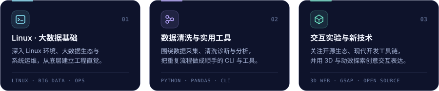
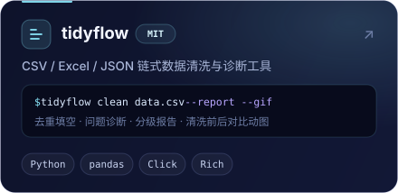
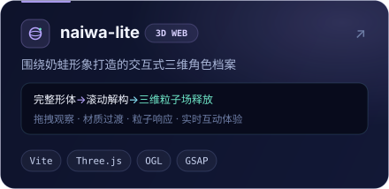
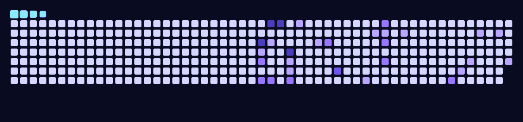

  <picture>
    <source media="(prefers-color-scheme: dark)" srcset="assets/hero-dark.svg" />
    <source media="(prefers-color-scheme: light)" srcset="assets/hero-light.svg" />
    
  </picture>

 

<strong>01 · FOCUS &amp; EXPLORATION</strong>

  <picture>
    <source media="(prefers-color-scheme: dark)" srcset="assets/focus-dark.svg" />
    <source media="(prefers-color-scheme: light)" srcset="assets/focus-light.svg" />
    
  </picture>

 

<strong>02 · FEATURED PROJECTS</strong>

  <a href="https://github.com/LiuliX-Xuan/tidyflow">
    <picture>
      <source media="(prefers-color-scheme: dark)" srcset="assets/project-tidyflow-dark.svg" />
      <source media="(prefers-color-scheme: light)" srcset="assets/project-tidyflow-light.svg" />
      
    </picture>
  </a>
  &nbsp;
  <a href="https://github.com/LiuliX-Xuan/naiwa-lite">
    <picture>
      <source media="(prefers-color-scheme: dark)" srcset="assets/project-naiwa-dark.svg" />
      <source media="(prefers-color-scheme: light)" srcset="assets/project-naiwa-light.svg" />
      
    </picture>
  </a>

 

<strong>03 · TECH STACK</strong>

  <picture>
    <source media="(prefers-color-scheme: dark)" srcset="assets/stack-dark.svg" />
    <source media="(prefers-color-scheme: light)" srcset="assets/stack-light.svg" />
    
  </picture>

 

<strong>04 · CONTRIBUTION ACTIVITY</strong>

  

 

  <picture>
    <source media="(prefers-color-scheme: dark)" srcset="assets/footer-dark.svg" />
    <source media="(prefers-color-scheme: light)" srcset="assets/footer-light.svg" />
    
  </picture>

